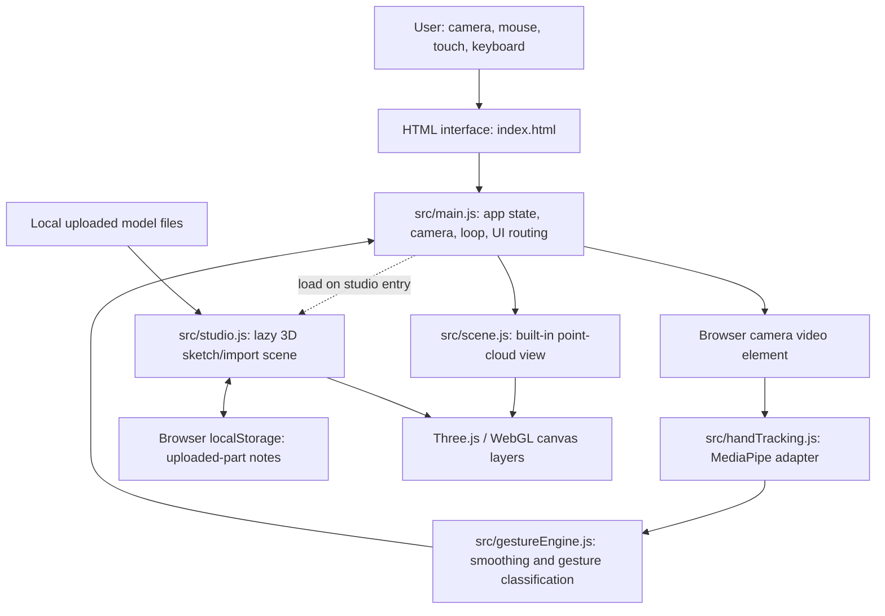
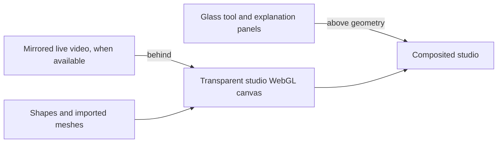

# Architecture and data

**Audit date:** 2026-10-11

## 1. Runtime shape

HoloHand is a Vite-served browser application. Its interaction logic is in ES modules, Three.js renders point-cloud and teaching geometry, and MediaPipe Tasks Vision runs hand landmark inference in the browser. There is no application server or account system. Static model/tracker assets may be served from `public/`; optional CDN fallback is used for hand-tracker assets if local setup is unavailable.

## 2. Module ownership

| File or folder | Responsibility | Important boundary |
|---|---|---|
| `index.html` | App shell, controls, video/canvas layers, studio/whiteboard markup | Keep IDs referenced by `src/main.js` in sync |
| `src/main.js` | Coordinates modes, camera/tracker lifecycle, gesture locks, mouse/touch, UI, animation loop | Avoid putting geometry generation or hand classification here |
| `src/handTracking.js` | Loads MediaPipe WASM/model, GPU then CPU fallback, returns tracked landmarks | Inference is only initialized when requested; camera permission is separate |
| `src/gestureEngine.js` | Landmark-to-gesture classification and temporal smoothing | Exposes normalized hand data; should not perform application actions |
| `src/scene.js` | Built-in model selection, point clouds, labels, explosion/rotation/selection | Keeps renderer budget and model interaction behavior |
| `src/studio.js` | Teaching geometry creation, model import, part selection, notes, undo, studio camera/rendering | Loaded on demand; local file resources only |
| `src/models/*.js` | Declarative model geometry and part metadata | Descriptions should be factual and maintainable |
| `src/models/index.js` | Model registry | Register built-in models here |
| `src/utils.js` | Shared helpers such as clamping | Keep app-specific policy in owning module |
| `src/agent.js` | Deterministic perception/intent/action agent abstraction | Appears separate from studio/main runtime; confirm usage before changing/removing |
| `src/objects/*` | Additional object/data definitions | Their current integration is not obvious from the root runtime map; inspect references before extending |
| `scripts/setup.mjs` | Copies/downloads tracking runtime assets during install | External download behavior must be documented and errors should preserve fallback |
| `public/` | Static assets (including generated tracking runtime/model when setup succeeds) | Never treat a missing local tracker asset as proof that camera is unavailable |

## 3. Runtime data flow

### Hand input

1. The user requests camera/hand mode from a direct click.
2. `getUserMedia` requests a user-facing video stream; no microphone is requested.
3. `HandTracker` resolves local WASM/model assets first and then configured CDN fallbacks; it tries GPU, then CPU.
4. The main loop invokes inference on new video frames only.
5. `GestureEngine` smooths landmark positions and classifies gestures.
6. `handForTask()` follows the active task’s locked hand identity through brief tracking gaps/relabeling; the studio or board applies the interaction and publishes status text.

### Models and geometry

- Built-in content is represented as named parts with point samples, colors, and descriptions. `src/models/index.js` is the registry; model constructors live under `src/models/`.
- Uploaded model bytes enter from a user-selected `File` list, are parsed in-memory, normalized to fit the viewer, and placed in the studio scene. Source bounds are retained for reporting; fit scaling is a display transform, not a unit conversion.
- GLB/GLTF, OBJ, STL, FBX, and PLY loaders are dynamically imported. OBJ materials and textured formats may need companion files selected in the same file picker. Missing local resources produce an error; model-provided URLs are not fetched as a trusted automatic source.
- Uploaded mesh names are exposed as part labels. Presenter notes are stored in browser `localStorage` using a key derived from filename, size, modification time, mesh order, and name. This is convenient local metadata, not a globally unique asset identity or a portable project format.
- Sketches use Three.js geometry in scene coordinates. Free/rect/circle profiles use extrusion; box/sphere/cylinder/cone are primitive tools. Coordinates and bounds are educational/illustrative, not calibrated manufacturing dimensions.

### Render layers

The studio renderer uses `alpha: true` and clear alpha 0. The scene background and fog are explicitly `null`; there is no floor, grid, or backdrop mesh. Camera passthrough is conditional on a working camera stream and the `.feed` style. If camera startup fails, the normal page background remains visible through the clear canvas.

## 4. Data and privacy inventory

| Data | Source | Processing / storage | Leaves browser? |
|---|---|---|---|
| Camera frames | Browser camera permission | Video element and local MediaPipe inference | No application upload; browser/OS camera permission applies |
| Hand landmarks/gestures | Camera frames | In-memory objects in the app loop | No |
| Built-in model definitions | Project source | Static app bundle | Served by development/build host |
| Uploaded 3D files | User file picker | In-memory parse and current page scene | No |
| Presenter notes for model part | User text | `localStorage` on this browser/profile | No |
| Sketches and imported scene | User gestures/files | Current app runtime memory | Not currently saved as a lesson file |
| Tracker binaries | Local `public/` setup or configured CDN fallback | Loaded into browser for hand inference | CDN fetch occurs only if local assets are missing |

## 5. Failure boundaries and constraints

- Camera can fail because no device is exposed, permission is denied, or the page is not in a secure context. The previous launch attempt displayed “No camera found”; verify on the target computer rather than treating this as a code-wide hardware diagnosis.
- Tracker initialization can fail independently from camera startup if WASM/model downloads or GPU/CPU delegates fail. The UI should retain mouse/touch fallback.
- Large meshes can consume substantial memory and slow rendering; there is no upload size/triangle-budget gate in this release.
- Import support is not equivalent to support for every extension of those formats. Validate assets from the target CAD/export pipeline.
- Browser `localStorage` can be cleared, quota-limited, or shared between same-origin users under the same browser profile. Notes should not be treated as confidential or as the only copy of lesson content.
- 3D model semantic labels may be absent or misleading. Display source labels and authored notes, not inferred part functions.
