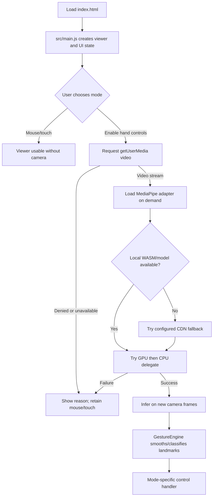
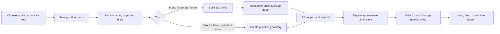
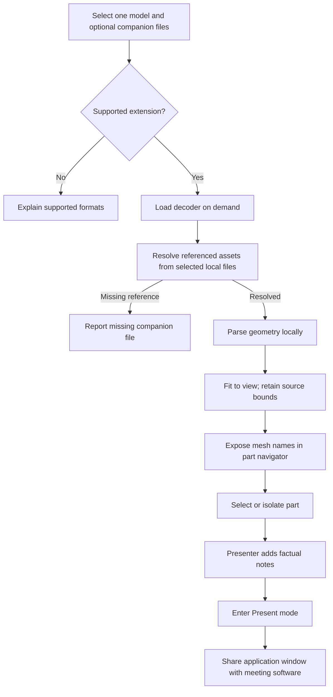
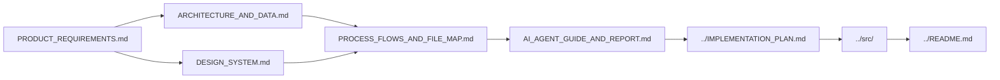

# Process flows and file map

**Audit date:** 2026-10-11

## 1. App startup and camera flow



## 2. Gesture continuity and active-task lock

```mermaid
stateDiagram-v2
  [*] --> Idle
  Idle --> TaskStarted: pinch begins a stroke, push/pull, or drag
  TaskStarted --> Locked: save hand ID and last usable pose
  Locked --> Updating: hand visible and same ID tracked
  Updating --> Locked: update gesture target
  Locked --> ShortTrackingGap: temporary missing/relabelled frames
  ShortTrackingGap --> Locked: same hand returns or unique nearby hand rebinds
  ShortTrackingGap --> Locked: keep last pose; never assign task to a different unrelated hand
  Locked --> Completed: deliberate release or explicit Finish control
  Updating --> Completed: deliberate release or explicit Finish control
  Completed --> Idle
```



## 3. Sketch-to-solid workflow



## 4. Uploaded-model presentation flow



## 5. Source file map

```mermaid
flowchart TB
  HTML[index.html] --> MAIN[src/main.js]
  CSS[src/styles.css] --> HTML
  MAIN --> VIEW[src/scene.js]
  MAIN --> TRACK[src/handTracking.js]
  MAIN --> GEST[src/gestureEngine.js]
  MAIN -. lazy import .-> STUDIO[src/studio.js]
  VIEW --> REG[src/models/index.js]
  REG --> MODELS[src/models/*.js]
  MODELS --> SHAPES[src/models/shapes.js]
  TRACK --> MP[@mediapipe/tasks-vision]
  VIEW --> THREE[three]
  STUDIO --> THREE
  SETUP[scripts/setup.mjs] --> ASSETS[public tracker assets, when setup succeeds]
  README[README.md] --> HANDBOOK[docs/]
  HANDBOOK --> ROADMAP[IMPLEMENTATION_PLAN.md]
```

### Code locations by task

| Task | Start here | Related files |
|---|---|---|
| Add a built-in teaching model | `src/models/index.js` | `src/models/*.js`, `src/models/shapes.js`, `src/scene.js` |
| Change gesture recognition | `src/gestureEngine.js` | `src/handTracking.js`, `src/main.js` |
| Change camera/tracker lifecycle | `src/main.js` | `src/handTracking.js`, `index.html` |
| Change whiteboard behavior | `src/main.js` | `index.html`, `src/styles.css` |
| Change 3D sketching, extrusion, import, notes | `src/studio.js` | `src/main.js`, `index.html`, `src/styles.css` |
| Change the no-mat/transparent composition | `src/studio.js` | `src/styles.css`, video layer in `index.html`, camera styles in `src/styles.css` |
| Change visual tokens/layout | `src/styles.css` | `index.html`, design system |
| Change dependency/setup behavior | `package.json` | lockfiles, `scripts/setup.mjs`, `public/` |

## 6. Handbook dependency map


