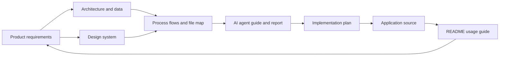

# HoloHand project handbook

This folder is the source of truth for understanding the product, code structure, intended behavior, and open work. It complements the runnable app README and the implementation roadmap.

## Documents

| Document | What it answers | Read when |
|---|---|---|
| [Product requirements](PRODUCT_REQUIREMENTS.md) | Who HoloHand is for, user journeys, functional requirements, quality goals, acceptance criteria, and scope boundaries | Planning features or checking whether a change solves the intended problem |
| [Architecture and data](ARCHITECTURE_AND_DATA.md) | Runtime components, module ownership, data flow, local storage, asset loading, privacy, and known constraints | Changing the application structure, tracking, rendering, or model data |
| [Process flows and file map](PROCESS_FLOWS_AND_FILE_MAP.md) | Mermaid diagrams for startup, hand-task locking, drawing/extrusion, upload/present, plus code and document dependency maps | Onboarding, debugging an interaction, or finding the right file |
| [Design system](DESIGN_SYSTEM.md) | Visual tokens, layout, interaction states, motion, accessibility, and transparent studio composition | Adding or changing interface elements |
| [AI agent instructions and implementation report](AI_AGENT_GUIDE_AND_REPORT.md) | Working rules for future coding agents, completed work, current evidence, known gaps, and recommended next steps | Resuming work with an AI coding agent or reviewing project status |

## Reading paths

- **New engineer or agent:** this page → architecture → process/file map → requirements → design system.
- **Educator or host:** requirements → current workflows in the root [README](../README.md) → implementation plan.
- **Feature planning:** requirements → design system → architecture → roadmap.
- **Handoff:** AI agent guide/report → architecture → process/file map.

## Relationship map

## Document maintenance

Update requirements when intended behavior changes. Update architecture and file maps when ownership or data flow changes. Keep the AI report evidence-based: label implemented, verified, and pending work separately. Do not treat roadmap items as shipped features. All dates in this handbook use the current project audit date, 2026-10-11.
